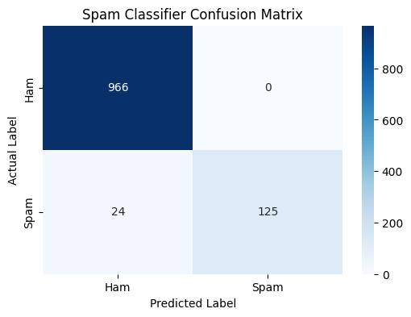

# SMS Spam Message Classifier

An AI/ML project built for the **CodeNova Internship (Task 2)**. This application utilizes Natural Language Processing (NLP) techniques and Machine Learning to accurately classify text messages as either **Ham (Legitimate)** or **Spam**.

---

## 📌 Project Overview
- **Objective:** Train a supervised Machine Learning model to detect spam SMS messages.
- **Algorithm:** Multinomial Naive Bayes (`MultinomialNB`) combined with TF-IDF vectorization.
- **Dataset:** SMS Spam Collection dataset containing 5,572 labeled messages (4,825 Ham, 747 Spam).

---

## 🛠️ Tech Stack & Tools
- **Language:** Python
- **Libraries:** `pandas`, `numpy`, `scikit-learn`, `matplotlib`, `seaborn`
- **NLP Methods:** TF-IDF Vectorization, Stop Words Removal, Lowercasing

---

## 📊 Model Performance & Results
- **Overall Accuracy:** ~97.8%

### Classification Metrics:
| Metric | Class 0 (Ham) | Class 1 (Spam) |
| :--- | :---: | :---: |
| **Precision** | 0.98 | 1.00 |
| **Recall** | 1.00 | 0.84 |
| **F1-Score** | 0.99 | 0.91 |

---

## 📈 Confusion Matrix


---

## 🚀 How to Run the Code
1. Clone this repository:
   ```bash
   git clone [https://github.com/YOUR_USERNAME/codenova-task2-spam-classifier.git](https://github.com/YOUR_USERNAME/codenova-task2-spam-classifier.git)
